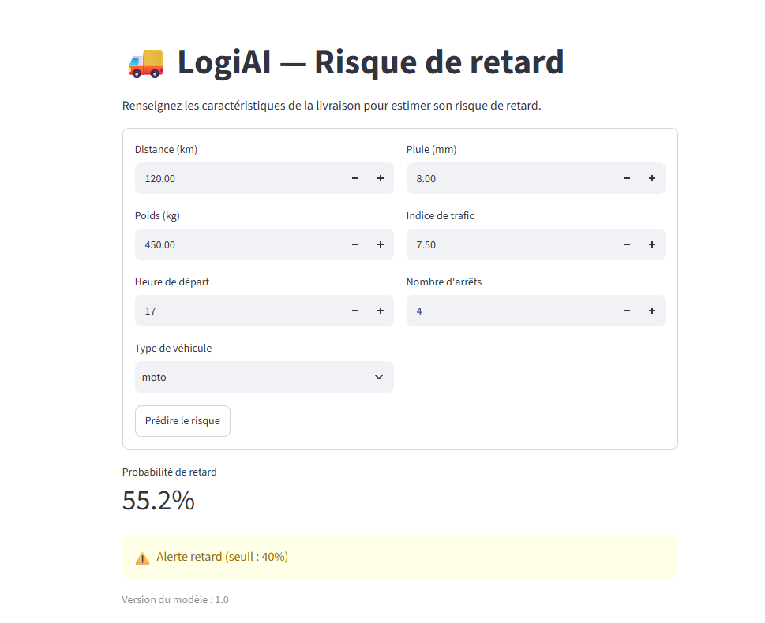

# Compte rendu : TP API LogiAI

**Noms :** Reddad Chaouay & Houssam Nassih  **Groupe :** G3

## 1. Environnement et premiers tests
- Sortie observée de `python -m pytest` :

  ```text
  collected 13 items
  tests\test_api.py ............. [100%]
  13 passed, 1 warning
  ```

  L'avertissement concerne une dépréciation de `starlette.testclient` et n'empêche pas les tests de réussir.
- Pourquoi certains tests qui attendent un 422 passent-ils déjà, alors que rien n'est écrit ?  
  FastAPI utilise le schéma Pydantic `Livraison` pour valider automatiquement les requêtes. Les champs manquants, les types incorrects et les valeurs hors limites sont rejetés avant l'exécution de `predict()`, avec le code HTTP 422.

## 2. Mon schéma
- Mes bornes et leur justification :

| Variable | Min | Max | Pourquoi |
|---|---|---|---|
| distance_km | 1 | 1000 | Une distance doit être positive et rester dans une plage réaliste pour ce projet. |
| poids_kg | 0 | 3000 | Un poids ne peut pas être négatif ; 3000 kg est la limite choisie. |
| heure_depart | 0 | 23 | L'heure de départ est exprimée sur 24 heures. |
| pluie_mm | 0 | 100 | La quantité de pluie ne peut pas être négative ; 100 mm est la limite choisie. |
| trafic_index | 0 | 10 | L'indice de trafic est défini sur une échelle de 0 à 10. |
| nb_arrets | 0 | 12 | Le nombre d'arrêts est entier et ne peut pas être négatif. |

## 3. Ma fonction predict()

```python
@app.post("/v1/predict", response_model=PredictionOut)
def predict(livraison: Livraison):
    predictor = state.get("predictor")
    if predictor is None:
        raise HTTPException(status_code=503, detail="Modèle non chargé. Vérifiez que le fichier model.joblib existe.")
    return PredictionOut(**predictor.predict(livraison.model_dump()))
```

## 4. Quatre requêtes
| Requête | Code obtenu | Pourquoi |
|---|---|---|
| livraison normale | 200 | Les données sont valides et le modèle renvoie une prédiction. |
| distance_km = -5 | 422 | La distance est inférieure à la limite minimale de 1 km. |
| type_vehicule = "avion" | 422 | Le type de véhicule n'appartient pas aux valeurs autorisées (`moto`, `fourgon`, `camion`). |
| modèle absent (simulé par le test) | 503 | L'API ne peut pas effectuer la prédiction si le modèle n'est pas chargé. Le test simule ce cas ; il n'est pas nécessaire de supprimer `models/`. |

## 5. Questions de compréhension
1. Le modèle est chargé une fois au démarrage pour éviter de le recharger à chaque requête, ce qui ralentirait les réponses.
2. Pydantic applique ce contrôle à partir du schéma `Livraison`, dans `logiai/api/schemas.py`, où `pluie_mm` est défini avec `ge=0` et `le=100`.
3. Le code 422 indique que les données envoyées ne respectent pas le schéma. Le code 503 indique que le service ne peut pas effectuer la prédiction, ici parce que le modèle n'est pas chargé.
4. Le préfixe `/v1` indique la version de l'API et permet de faire évoluer l'API sans remplacer immédiatement cette version.
5. Déclarer la distance en `int` empêcherait de représenter naturellement des fractions de kilomètre. Le type `float` permet, par exemple, une distance de 12,5 km.

## 6. Décision : modèle absent
Le projet choisit de démarrer l'API et de répondre 503 aux prédictions tant que le modèle est absent. Cela permet notamment à l'API de signaler son état, mais les prédictions restent indisponibles. Refuser de démarrer éviterait de lancer un service incapable de prédire, mais empêcherait aussi d'accéder à ses autres routes, comme `/health`.

## 7. Lien de la pull request
Non applicable : aucune pull request n'a été créée.

## 8. Capture de l'interface Streamlit



